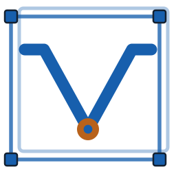

# vosulay branding

vosulay is an 18-LAB product (stage code 18-02). Its art shares vosu's rules and colours (vosu `docs/branding.md`) and the first-party tool art family (vosu-tools `docs/art.md`). The terms are in [`assets/branding/LICENSE.md`](../assets/branding/LICENSE.md).

## Mark



vosulay's 1.x mark in 18-LAB colours: two offset overlay-layout frames with corner handles hold vosu's signal V and its node (vosu `docs/branding.md`).

- Geometry (original 128-unit coordinates): frames at (14, 6) and (8, 12), 108×104, radius 3, strokes 2.5 at 34 % and 2.75 at 78 % opacity; the V `M18 36 H32 L64 94 L96 36 H110` at 8.5 units with round caps; the node a ring (radius 8, hole 3.2) at (64, 94); 9-unit handles with 1.25-unit outlines on the front frame's corners.
- Never recolour beyond the roles below, outline, rotate, add effects, or drop the frames, handles or node.
- 16 and 24 px have pixel-fitted masters (`vosulay-app-icon-16.svg`, `vosulay-app-icon-24.svg`); the handles drop out at 16 px. From 32 px up the master scales.

| Role | Light (DRAFTING) | Dark (WORKSTATION) |
| --- | --- | --- |
| Frames, V, handles (accent) | `#175fad` | `#ff963f` |
| Node (signal) | `#b8621b` | `#7fa6cf` |
| Handle outline, wordmark | `#132030` | `#ebe8e1` |
| Rule, endorsement | `#a7b2bd`, `#3b4858` | `#3b3f45`, `#b8b5ad` |

The app icon puts the mark on a graphite (`#111214`) tile with 12 % corner radius, at the 1.x icon's size and position. The editor toolbar draws the mark inline with `--accent`, `--signal` and `--fg`.

## Lockup

`vosulay-logo.svg` (light surfaces) and `vosulay-logo-on-dark.svg`: the mark and the geometric lowercase vosulay wordmark from 1.x, a hairline rule, and the 18-LAB logotype as endorsement in one ink colour. The 18-LAB logotype's mark stands in for "18"; never set a typed "18" beside it. Use it at 64 px height or more, where the endorsement stays legible; smaller, use the mark alone.

## Files

| File | Use |
| --- | --- |
| `vosulay-app-icon.svg` | Master app icon; Linux `hicolor/scalable` icon (packages and the self-registered desktop entry) |
| `vosulay-app-icon-16.svg`, `vosulay-app-icon-24.svg` | Pixel-fitted small masters |
| `vosulay-mark.svg` | Mark without tile, follows `prefers-color-scheme` |
| `vosulay-logo.svg`, `vosulay-logo-on-dark.svg` | Lockup |
| `vosulay-banner.svg`, `vosulay-banner-light.svg` | README header, 1280×320, chosen with `<picture>` |
| `vosulay-social-preview.svg` / `.png` | GitHub repository social preview, 1280×640; upload the PNG in the repository settings |
| `vosulay.ico` | `vosulay.exe`, shortcuts and the uninstall entry: 16, 20, 24, 32, 40, 48, 64, 128 (DIB) and 256 (PNG) |
| `icons/vosulay-<size>.png` | Windows tray, 16–48 px; the tray picks the size for the display scale |
| `vosu-tool-icon.svg`, `vosu-tool-banner.svg` | vosu catalog card art (tool art family) |

## Rendering

The SVG files are the source; every raster is generated and committed, so builds and packages need no image tools. After changing a master:

```sh
python3 tools/branding/render.py           # needs resvg on PATH (0.48)
python3 tools/branding/render.py --check   # committed rasters match the masters
```

Text in the banners and social preview, and the 18-LAB logotype, is outlined, so it renders without fonts on GitHub and in image viewers. It was set in Barlow Condensed 600, Barlow 400 and IBM Plex Mono 500 (Fontsource Latin subsets, as in vosu's `assets/server/`) with HarfBuzz shaping and fontTools outlines. To change a line, outline the new text from the same fonts, keep sizes and positions, and re-render.
