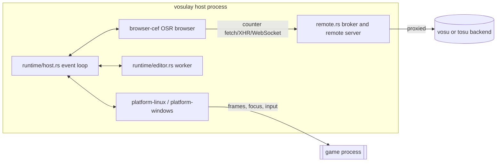

# vosulay runtime architecture

## Runtime composition

One native Rust process hosts everything on both platforms. It renders the
whole overlay profile in a single pinned CEF off-screen (OSR) browser and hands
the frames to the platform layer, which draws them inside the game.

Startup order, from [`src/runtime/host.rs`](../../src/runtime/host.rs) `run`:

1. Return early if this process is a CEF subprocess (`execute_subprocess`).
2. Parse the command line ([`src/runtime.rs`](../../src/runtime.rs)) and load the configuration.
3. On Linux, refresh osu desktop launchers ([`src/runtime/launchers.rs`](../../src/runtime/launchers.rs)).
4. Run a one-time tosu import if applicable ([`src/runtime/tosu.rs`](../../src/runtime/tosu.rs)).
5. Build `ProductResources`, which holds the manager document and local-overlay authorization.
6. Start the loopback backend broker and the optional LAN remote server ([`src/remote.rs`](../../src/remote.rs)).
7. Start the platform controller and the editor worker.
8. Enter the event loop.

On Linux, [`src/main.rs`](../../src/main.rs) first re-executes a Cargo-built
binary from the retained CEF runtime directory, because CEF loads ICU and GPU
assets beside the executable. Windows enters through CEF's sandbox bootstrap
(`RunWinMain`).

Shutdown releases input capture before stopping the browser or worker. It gives
the worker five seconds to drain, then stops the platform layer, closes the
browser, and drops the CEF runtime. CEF initializes lazily when a game is
attached and is never reinitialized in the same process.

## Browser, manager page, and bridge

[`crates/browser-cef`](../../crates/browser-cef) wraps CEF.

- **Schemes.** `vosulay://manager/index.html` serves only the embedded manager
  document. `vosulay-overlay://<capability>/…` serves authorized local HTML
  overlays. [`scheme.rs`](../../crates/browser-cef/src/scheme.rs) caps resources
  at 32 MiB and requires the product's `ResourceService` to re-authorize every
  local request.
- **Manager document.** [`src/ui.rs`](../../src/ui.rs) builds it at compile time
  from [`assets/manager.html`](../../assets/manager.html),
  [`manager.css`](../../assets/manager.css), and
  [`manager.js`](../../assets/manager.js). CSS and JavaScript are inserted as
  escaped string literals, so `</script>` in an asset cannot end the bootstrap.
- **Native bridge.** [`bridge.rs`](../../crates/browser-cef/src/bridge.rs)
  installs `__VOSULAY_NATIVE_POST__` only in the trusted frame: the main frame
  whose URL is exactly the manager URL.
  - The manager script captures the function and deletes the global.
  - Messages must be non-empty strings of at most 256 KiB, and at most 64 may be
    pending.
  - Calls from any other frame, or from a context that no longer matches the
    frame, are rejected.
  - Counter and overlay frames never receive the bridge.
- **Counter routing.** Every other frame gets the
  [`assets/backend.js`](../../assets/backend.js) routing script. It rewrites
  `fetch`, XMLHttpRequest, and WebSocket URLs aimed at the configured backend so
  they go to the loopback broker instead. It also sets `COUNTER_PATH` from the
  frame path unless a string value already exists.

The host exchanges JSON envelopes with the manager:

- **Manager to host:** `heartbeat`, `flush-complete`/`flush-failed`,
  `import-tosu-layout`, and so on.
- **Host to manager:** `editing`, `flush-save`, `error`, and so on.

Heartbeats carry a nonce. If the heartbeat expires during editing, capture is
released within the five-second bound.

## Editor worker

[`src/runtime/editor.rs`](../../src/runtime/editor.rs) runs blocking work off
the event loop:

- counter catalog fetches ([`src/api.rs`](../../src/api.rs));
- revision-checked configuration saves;
- native file dialogs (`rfd`) for local overlays, profile import/export, and
  tosu layout import;
- opening backend pages.

Saves are rejected with `conflict` if the configuration revision has changed
since the request. A local HTML overlay selection creates a fresh 128-bit
capability token and registers it with `ProductResources` before its URL
returns to the page.

## Backend broker and remote server

[`src/remote.rs`](../../src/remote.rs) always binds a loopback listener for the
in-game browser, so counters still load when the LAN port is occupied.

When the bind succeeds, it also listens on `remote_listen_host:remote_listen_port`
for view-only profile pages. Telemetry WebSockets are shared per schema by
[`src/backend.rs`](../../src/backend.rs). See
[vosu catalog, overlay sources, and remote pages](../integrations/vosu-and-overlays.md).

## Linux frame path

- **Producer.** The host publishes complete BGRA frames into a sealed
  three-slot memfd ring
  ([`crates/frame-transport/src/ring.rs`](../../crates/frame-transport/src/ring.rs)).
  It skips identical frames and accumulates damage per slot.
- **Control channel.** Control and descriptor hand-off use a nonblocking
  `SOCK_SEQPACKET` socket
  ([`ipc.rs`](../../crates/frame-transport/src/ipc.rs)). The default abstract
  address is `@vosulay-<euid>`. Peers are authenticated with `SO_PEERCRED`, so
  only the same user can connect. Pixels never travel over the socket.
- **Consumer.** The injected compositor
  ([`crates/overlay-linux`](../../crates/overlay-linux)) takes the newest
  complete frame at game present and uploads it to a reusable GPU texture.
  Hooks cover Vulkan presentation (as a layer), EGL/GLX swaps, and SDL. The
  leading [`overlay-lookup`](../../crates/overlay-lookup) helper routes explicit
  `dlsym` lookups to those hooks.
- **Attachment.** The compositor gets into the game through `LD_PRELOAD` or the
  Vulkan layer at launch, or through explicit live attachment. Live attachment
  ([`platform-linux/src/injector.rs`](../../crates/platform-linux/src/injector.rs))
  uses `ptrace` to call `dlopen` in a same-user native x86_64 process.
- **Selection.** [`platform-linux`](../../crates/platform-linux) follows
  authenticated focus notifications, not process order.

## Windows frame path

[`crates/platform-windows`](../../crates/platform-windows) attaches to the
focused supported `osu!.exe` or `osulazer.exe` through asdf-overlay 2.1.0.

CEF's callback-borrowed D3D11 texture is copied into reusable application-owned
GPU textures ([`d3d11.rs`](../../crates/platform-windows/src/d3d11.rs),
[`gpu_mailbox.rs`](../../crates/platform-windows/src/gpu_mailbox.rs)) before the
callback returns. The normal path has no CPU readback.

[`target_selection.rs`](../../crates/platform-windows/src/target_selection.rs)
implements focus-based target selection, and
[`tray.rs`](../../crates/platform-windows/src/tray.rs) the tray icon.

## Build boundary

The CEF build script
([`crates/browser-cef/build.rs`](../../crates/browser-cef/build.rs)) acquires and
verifies the pinned CEF distribution. On Linux, the root
[`build.rs`](../../build.rs) retains the CEF runtime and the built compositor
and lookup libraries, then embeds their paths in the binary.

See [build and run operations](../operations/build-and-run.md) and the
[testing guidance](../testing/guidance.md).
