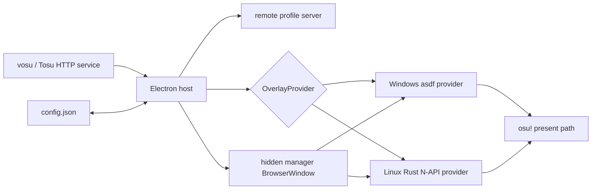
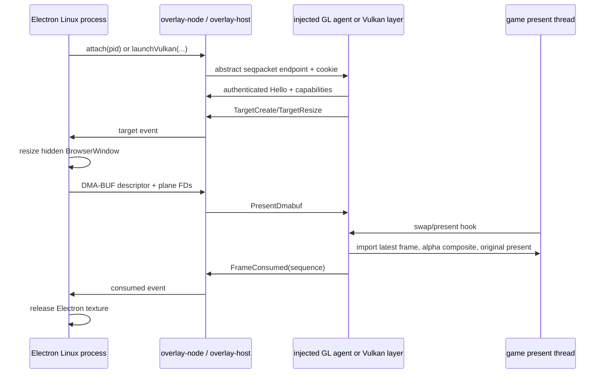

# vosulay architecture overview

## System boundary

vosulay is one Electron desktop host with platform-specific in-game renderers. It owns profiles, placement editing, counter discovery, local-file capabilities, view-only remote pages, tray/shortcuts, process selection, and offscreen Chromium documents. Vosu or Tosu remains a separate HTTP service. osu! remains the target game process.

The old Qt, CXX, LayerShellQt, desktop overlay window, Qt WebEngine runtime plumbing, and root Rust application were removed. `desktop/` is the canonical application package on Linux and Windows; `native/` contains only Linux attachment, transport, compositor, and bootstrap code.

## Shared Electron host

[`desktop/src/main/index.ts`](../../desktop/src/main/index.ts) parses invocation options before readiness, enforces a single instance, registers custom schemes, loads the canonical configuration, starts the remote server, creates tray/global-shortcut commands, creates the current platform provider, and performs ordered shutdown.

[`OverlayProvider`](../../desktop/src/main/overlay-provider.ts) is the stable host-facing contract:

- start/stop lifecycle;
- editing and visibility state;
- flush-before-destructive-transition;
- reload all active renderer documents;
- editing/visibility events for tray state.

[`provider-factory.ts`](../../desktop/src/main/provider-factory.ts) uses dynamic imports so Linux never evaluates asdf or active-window dependencies and Windows never loads the Rust addon. Both providers use [`OverlayManager`](../../desktop/src/main/overlay-manager.ts), whose serialized reconciliation selects a valid target PID, preserves last-focused-game behavior, applies visibility/editing, detaches stale processes, and waits for scans/transitions during shutdown.

A `ManagedOverlayProcess` owns exactly one target attachment and manager BrowserWindow. It must flush pending saves before destructive changes, reload its Chromium document on request, and emit `destroyed` exactly once.

## Canonical services

The shared TypeScript services are the only domain implementation:

- [`config.ts`](../../desktop/src/main/config.ts): schema normalization, revisions, subscriptions, and atomic persistence;
- [`counters.ts`](../../desktop/src/main/counters.ts) and [`urls.ts`](../../desktop/src/main/urls.ts): bounded vosu/Tosu discovery and stable URL semantics;
- [`local-overlays.ts`](../../desktop/src/main/local-overlays.ts): custom-scheme capability registry and path confinement;
- [`host-bridge.ts`](../../desktop/src/main/host-bridge.ts): manager message protocol and revision-aware saves;
- [`remote-server.ts`](../../desktop/src/main/remote-server.ts): protected view-only profile and local-resource routes;
- [`manager-document.ts`](../../desktop/src/main/manager-document.ts): safe packaged document assembly.

See [configuration](../domain/configuration.md) and [integrations](../integrations/vosu-and-overlays.md) for the contracts.

## BrowserWindow model

Each attached target uses a hidden transparent BrowserWindow loading `vosulay://manager/index.html`. It is context-isolated, sandboxed, has Node integration disabled, denies popups/webviews/navigation, and renders offscreen with shared textures. The viewport follows the native target size, falling back to `1280x720` until a target exists. Chromium FPS is bounded by the configured `fpsLimit`.

The same document provides display and edit modes. Display frames are composited into the game and game input passes through. Edit mode reveals manager controls, asks the native backend to capture target input, and forwards normalized input back into the hidden document. A host/native disconnect ends capture and returns the manager state to non-editing.

## Windows provider

[`windows-overlay-provider.ts`](../../desktop/src/main/windows-overlay-provider.ts) loads `@asdf-overlay/core`, `@asdf-overlay/electron`, and `@paymoapp/active-window` only at runtime on Windows. [`overlay-process.ts`](../../desktop/src/main/overlay-process.ts) keeps the existing asdf shared-GPU-surface and input-forwarding model. Windows is deliberately not reimplemented in Rust during this migration.

## Linux control/data path

[`overlay-protocol`](../../native/crates/overlay-protocol/src/lib.rs) defines explicit little-endian packet codecs, version/capability negotiation, hard dimensional and payload limits, abstract Linux `AF_UNIX` `SOCK_SEQPACKET` transport, `SO_PEERCRED`, and `SCM_RIGHTS` handling. Protocol payloads never borrow packed Rust structures.

[`overlay-host`](../../native/crates/overlay-host/src/lib.rs) creates a random abstract socket suffix and random session cookie, validates UID plus target PID or authenticated process group, performs the handshake within a deadline, owns targets/frame FDs, and exposes host events. Process-group authentication permits secure launch-time Vulkan helpers/children without accepting arbitrary same-UID clients.

[`overlay-node`](../../native/crates/overlay-node/src/lib.rs) is the N-API boundary. It exposes attach, surface, visibility/editing/capture, event, late-profiler-attach, and Vulkan-launch operations to TypeScript. It stages no domain configuration in Rust.

[`overlay-agent-core`](../../native/crates/overlay-agent-core/src/lib.rs) owns the target-process connection, latest-frame mailbox, bounded input queue, capture state/watchdog, and fail-open disconnect behavior. Control I/O runs away from graphics hooks.

[`overlay-agent-gl`](../../native/crates/overlay-agent-gl/src/lib.rs) interposes GLX/EGL, SDL, and `dlsym` symbols. It restores mutated GL state, alpha-composites the newest valid frame, and always calls the original swap. SDL polling/wait hooks normalize captured edit input and block it from the game only while authenticated capture is active.

`dlsym` interposition is required, not incidental: Wine's `winex11.drv` links no GL provider. It `dlopen`s libGL, resolves `glXSwapBuffers` with `dlsym`, and calls it through a stored pointer, so neither `LD_PRELOAD` symbol interposition nor PLT patching observes its presents. The interposer resolves glibc's own `dlsym` through libc's handle (`RTLD_NEXT` is unusable from a `dlopen`ed agent, which is how the CLR profiler loads it), hands out this agent's hook for the present entry points, and forwards every other lookup unchanged.

A preloaded agent claims the session on its first present, never at load time: `LD_PRELOAD` propagates to every child of a launched target — `wineserver`, `winedevice.exe`, `services.exe` — and the host accepts a single session, so a non-rendering helper would otherwise take it.

## Frame transport negotiation

Whether a target can sample an imported DMA-BUF depends on its graphics context, not on the process, so the agent probes on the presenting thread and advertises capabilities in its handshake:

- an EGL context is current: `CAP_DMABUF` plus shared memory;
- desktop GL: `CAP_SHM_BGRA`, letting Chromium's native BGRA bitmaps upload without a per-frame swizzle;
- shared memory alone is mandatory, so the host rejects an agent that cannot accept it.

The host grants the intersection with what it supports and exposes it as `supportsDmabuf()`/`supportsBgraShm()`. [`LinuxOverlayProcess`](../../desktop/src/main/linux-overlay-process.ts) then chooses `offscreen.useSharedTexture` or CPU frames before creating the BrowserWindow.

GLX contexts — Wine, and SDL games on X11 — are exactly the case that needs this. NVIDIA accepts `glEGLImageTargetTexture2DOES` in a GLX context without raising a GL error yet leaves the texture empty; sampling it returns opaque black and would erase the game's frame. The compositor therefore verifies the bound texture's dimensions and rejects an unusable import, and such targets receive shared-memory frames instead.

Chromium stores frames top-down while GL samples bottom-up, so the compositor inverts the vertical texture coordinate for every transport.

[`overlay-vulkan-layer`](../../native/crates/overlay-vulkan-layer/src/lib.rs) is an implicit Vulkan layer with correct loader negotiation and instance/device proc-address chaining. It tracks instances, physical/device identity, queues, swapchains, and images without one process-global compositor. [`compositor.rs`](../../native/crates/overlay-vulkan-layer/src/compositor.rs) imports supported external-memory frames, synchronizes uploads/composition, restores the game's present layout, and calls the real `vkQueuePresentKHR`. Without a valid session the layer is dormant.

[`overlay-dotnet-bootstrap`](../../native/crates/overlay-dotnet-bootstrap/src/lib.rs) is a minimal CLR profiler loaded through the packaged DiagnosticsClient attach tool. Its only job is to load/start the GL agent and then remain inert; no renderer or configuration logic lives in the profiler.

## Frame ownership and hot-path invariants

Electron shared textures have bounded lifetime. [`LinuxOverlayProcess`](../../desktop/src/main/linux-overlay-process.ts) permits at most two outstanding forwarded textures, drops/release new frames when full, assigns a monotonically increasing sequence, and releases a texture on `FrameConsumed`, target change, send failure, disconnect, or teardown. Latest frame wins inside the agent; no unbounded queue forms.

Graphics-hook invariants:

1. Never perform network or blocking host IPC on a present thread.
2. Never wait for a new overlay frame.
3. Avoid per-frame allocation after stable resources exist.
4. Never hold a mutex across the original swap/present call.
5. Catch panics at exported/hook boundaries; never unwind into the game.
6. Invalid frame/import/synchronization state disables or skips the overlay, not the game present.
7. Host disconnect immediately releases input capture.
8. The original game presentation is always attempted.

## Runtime modes

- **Attach existing native/GL target:** explicit/default PID discovery; native lazer can use profiler late attach.
- **Launch a target through the host:** `--launch-vulkan <executable> -- [args...]`; the host creates and authenticates the session before the child launches, prepends the staged GL agent to the child's `LD_PRELOAD`, and points the staged layer manifest at a stable packaged layer library. Wine/Proton targets use this mode, which is how a Windows game under Wine gets an in-process compositor.
- **Remote view:** profile documents are served independently of target attachment. Remote authorization never grants native control.

## Shutdown

SIGTERM, SIGINT, session end, tray exit, or application quit funnel through one bounded sequence: stop new provider work, flush manager saves, stop the remote server/config subscription, stop/destroy the provider and native session, destroy the tray, then exit. Failures are collected and produce a non-zero application exit rather than leaving capture intentionally active.

## Distribution boundary

`desktop/scripts/stage-native.mjs` builds and stages Linux addon/agent/profiler/layer artifacts under packaged resources outside ASAR. `desktop/scripts/verify-package.mjs` asserts canonical `vosulay` package identity, required platform artifacts, forbidden opposite-platform native modules, executable profiler attach tool, and non-empty preload/assets. The AppImage contains no Qt dependency.
